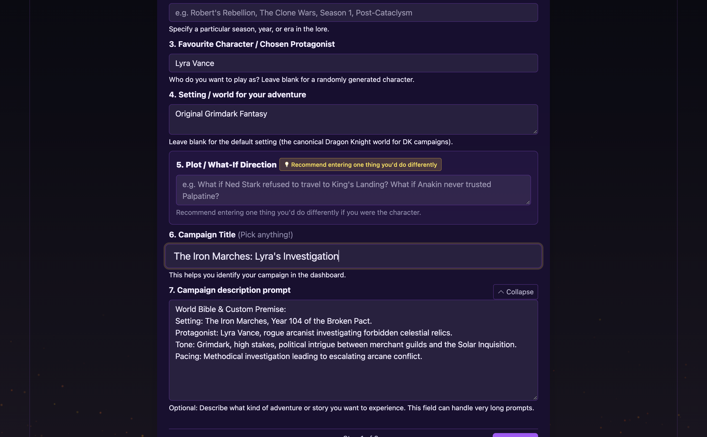
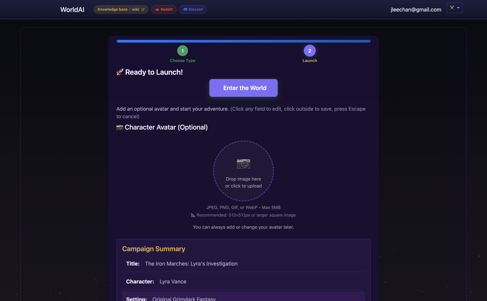

# Campaign Wizard

Everything between "I want to play" and your first scene happens in two screens.

```
Step 1: Choose Your Campaign  ──>  Step 2: Ready to Launch!  ──>  Scene 1: Character Review & Opening
```

The progress bar labels the two steps **Choose Type** and **Launch**; the footer counts "Step 1 of 2".

---

## Step 1 — Choose Your Campaign

Step 1 collects your world concept, protagonist, and campaign premise.



### Campaign type

Two cards, and **Play a campaign** is selected for you:

- **Play a campaign** — the recommended path for your own story. Build a custom world, universe, and protagonist; a short idea is enough to start.
- **Dragon Knight Campaign** — the optional quick start: written lore, a prebuilt hero, two companions, and a calibrated opening scene.

> **What Dragon Knight locks.** Picking **Dragon Knight Campaign** makes it a fixed module: the Universe, Timeline and Plot fields disappear, and Character ("Ser Arion"), Setting and the Campaign description prompt are filled in for you and greyed out. The Title is pre-filled to "Dragon Knight" but you can still change it. Switch back to **Play a campaign** to edit the rest — anything you had already typed comes back.

### Universe and setting inputs (sections 1–6)

- **Favorite Universe / TV Show / IP**: Eight one-click suggestions (Game of Thrones, Star Wars, Cyberpunk, The Witcher, Middle-earth, Stranger Things, Marvel, Dune), or type any other franchise or realm you like. These are text suggestions, not pre-built modules.
- **Timeline / Era (Optional)**: Anchor your story in a specific period (e.g. *Robert's Rebellion*, *The Clone Wars*, *Post-Cataclysm*).
- **Favourite Character / Chosen Protagonist**: Your character's name and archetype, or leave blank for a randomly generated protagonist.
- **Setting / world for your adventure**: A few lines on the physical, political, and magical environment.
- **Plot / What-If Direction**: The central conflict or departure point (e.g. *"What if Ned Stark refused to become Hand of the King?"*).
- **Campaign Title (Pick anything!)**: The name on your campaign card on the dashboard.

### Campaign description prompt (long-form world bible)

This is the **last** numbered section on Step 1 — section 7 on the **Play a campaign** path — and it starts collapsed, behind an **Expand** button. The heading and **Expand** button remain visible; the text box stays hidden until you open it. Open it and you get a large text box for pasting a whole campaign bible, premise, or set of house rules. (Pick Dragon Knight instead and the Universe, Timeline and Plot fields disappear, so the remaining sections renumber and this one arrives read-only.)

- **Capacity**: a 70,118-character bible (~11,000–12,000 words, about 25 pages) has been tested end to end and stored intact. Length is almost never your constraint.
- **What to paste here**: setting bibles (geography, factions, pantheons, magic systems); character backstory, lineage, equipment, psychology; custom rules, tone constraints, and god-mode style instructions.
- **Short vs. long**: a 1–3 sentence prompt gives the GM room to invent. A full bible enforces strict canon, complex politics, or a custom rules system.

Click **Next** to proceed to Step 2.

---

## Step 2 — Ready to Launch!

Step 2 is your avatar, a summary to check, and the launch button.



### 1. Enter the World

The **Enter the World** button sits at the top of Step 2, right under the heading — you do not have to scroll to find it. The same button repeats at the bottom of the screen, beside **Previous**. Clicking either one creates your persistent campaign, sets up the rules, and opens Scene 1.

### 2. Character portrait avatar

Choose **AI generate portrait** or **Upload your own**. The portrait is optional: you can enter the world without one and add it later.

**Generate a portrait**

1. Select **AI generate portrait**.
2. Read the suggested **Character description** and edit the appearance: face, hair, clothing, equipment, and distinguishing features.
3. Follow the portrait status. If generation has not started, choose **Generate portrait**; wait for the result before requesting another.
4. Check whether the portrait is already attached. If a preview is waiting for your decision, choose **Use this portrait** to apply it, **Regenerate** for another version, or **Cancel** to keep your current portrait.

Some app versions start the first wizard portrait after AI consent and keep it automatically when it replaces nothing you chose. An existing or uploaded portrait may require confirmation before replacement. You can still launch without a portrait; a generation or save error is not a reason to create another campaign.

**Upload your own image**

1. Select **Upload your own**.
2. Drop an image onto the upload circle or click it to choose a file.
3. Drag the image inside the circle to position it. Use the camera control to choose another image or the remove control to clear it.

Uploads accept JPEG, PNG, GIF, or WebP, up to 5 MB. A square image at least 512×512 pixels works well. The portrait appears in the campaign header, not beside every story turn; it is separate from your Google account picture.

You can add, replace, or remove it after launch. See [Your portrait in the game header](#your-portrait-in-the-game-header).

### 3. Campaign summary card & inline editing

Check your configuration before launching:
- Shows your Title, Character, Setting, and the first 50 characters of your Campaign description prompt. (Universe isn't repeated here.)
- Each row has a pencil button (**Edit title**, **Edit character**, **Edit setting**, **Edit description**) so you can fix a typo without going back to Step 1.
- Editing is inline: click the field, click outside it to save, or press **Escape** to cancel.

---

## After the wizard: Scene 1 Character Review

Character creation happens inside the story rather than on a separate form:

1. The GM introduces your character in the opening scene context.
2. The GM presents your generated character sheet (ability scores, class, starting spells, and equipment).
3. You review, request modifications, or finalize your build before your first major narrative decision.

---

## After launch: find your campaign details

Open **⋯ More game actions** and choose **Campaign details** to revisit your campaign information. The same menu is available on desktop and mobile.

### Your portrait in the game header

**If you skipped the avatar on Step 2**, tap the empty portrait slot in the game header. Choose **AI generate portrait** or **Upload photo**. The AI option lets you edit the character description and choose **Generate portrait**. When your campaign has no portrait, a successful result may save automatically; otherwise review it and choose **Use this portrait** when shown. Confirm that the avatar appears before closing the chooser. Upload opens your device's file picker.

**If you already have a portrait**, tap it to open its photo-management card:

- **AI Portrait** opens the AI description and preview controls so you can make a replacement.
- **Change Photo** lets you choose a replacement image. Position it in the crop overlay, then choose **Use This Crop**, or cancel to keep the current portrait.
- **Remove** asks for confirmation before clearing the portrait and restoring the empty slot.

Close the modal with its **×**, by clicking the dimmed backdrop, or by pressing **Escape**. Character stats (Level, HP, AC) are tracked in the header status bar and character sheet, not inside the photo modal.

---

## Player tips

- **Use the description prompt.** Have a homebrew world or a novel concept? Paste your notes straight into it — that is what it is for.
- **Pick one tone.** Slapstick comedy plus grimdark survival in the same prompt produces confused narration. Name a primary tone and stick to it.
- **Fix typos on Step 2.** Use the pencil buttons on the summary card instead of going back.
- **Want to customise Dragon Knight?** Only the Title and the Step 2 avatar (Ser Arion's portrait loads by default, and you can replace it). Every other field is locked — start from **Play a campaign** and describe the world you want instead.

See [CharacterCreation](CharacterCreation.md), [CampaignDesign](CampaignDesign.md), [GodModePrompting](GodModePrompting.md), and [How to Play](../queries/how-to-play-worldai.md). For the same flow on one screen, see [CampaignWizard](../entities/CampaignWizard.md).
