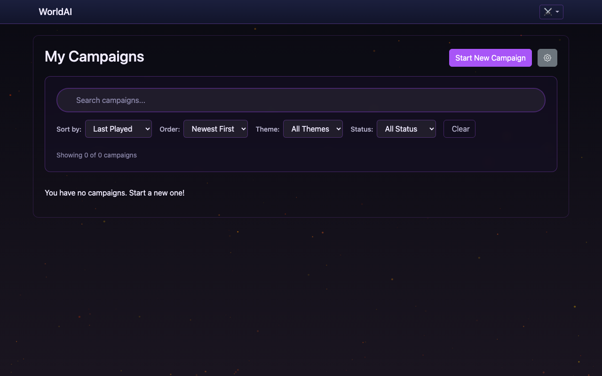
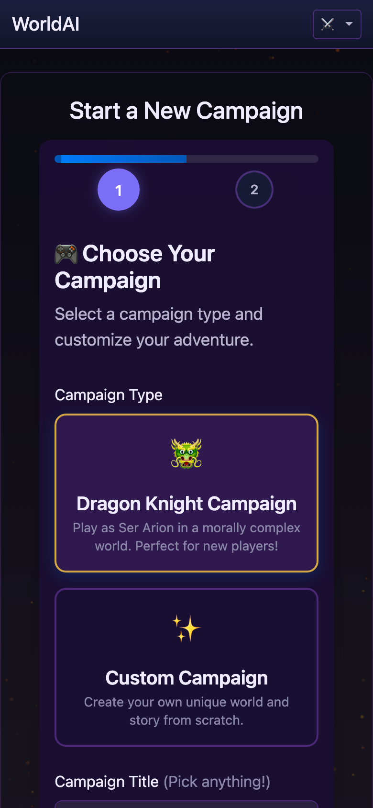
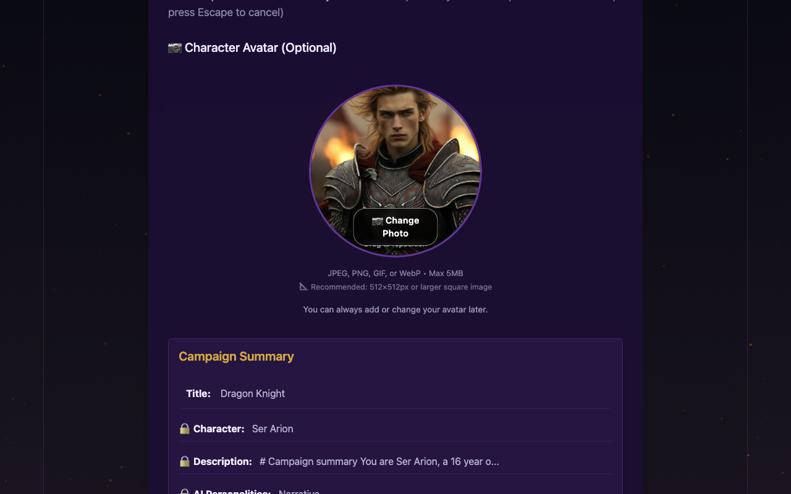
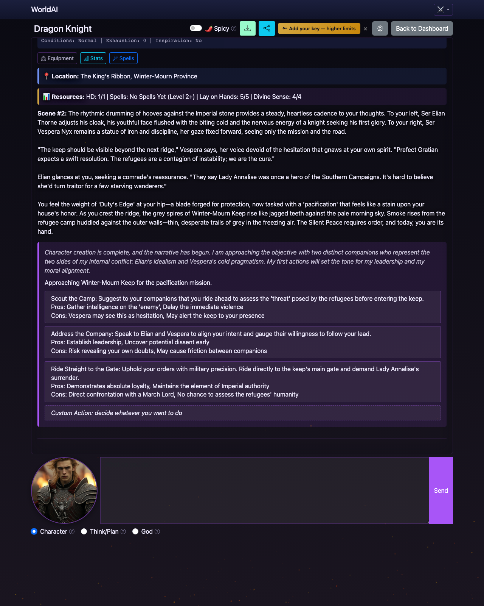
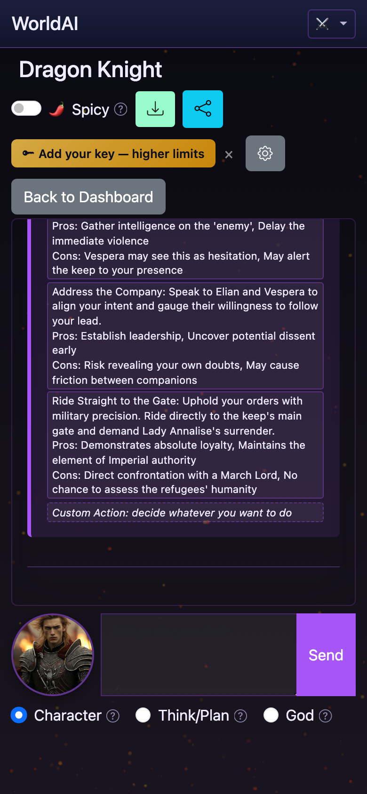
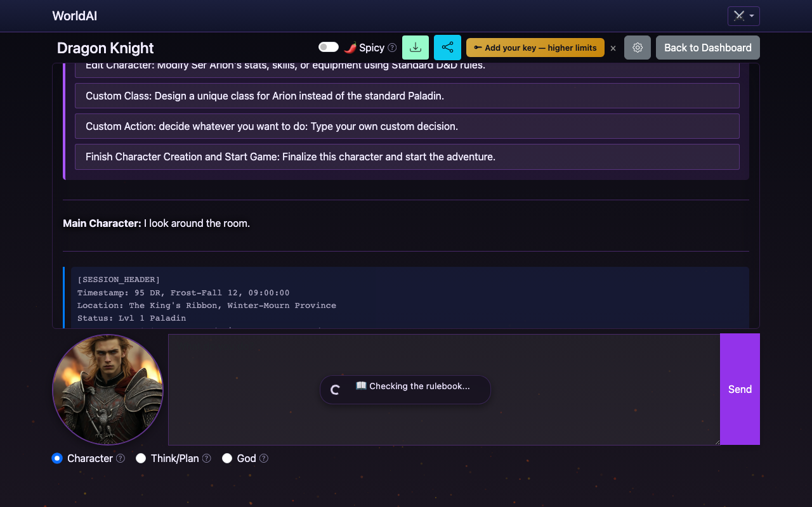

# How to Play WorldArchitect.AI

Your first 30 minutes with the game, step by step.

**The short version:** sign in, click **Play a campaign**, choose the custom path, describe the world and character you want, add an optional portrait, and **Enter the World**. You do not need to know the rules before playing. **Dragon Knight Campaign** is the ready-made quick start if you want to skip designing a world.

The Dragon Knight screenshots are real captures from a playthrough; the custom-world screenshot shows an example setup. They show an earlier interface: use the written steps for the current labels and controls. See [Screenshot provenance](#screenshot-provenance) for dates and viewports.

## Before you start

You'll need a web browser and a Google account. That's it — playing includes a daily turn allowance. If you pick Dragon Knight, you don't even need an idea for a setting.

## Step 1 — Sign in

1. Go to [worldarchitect.ai](https://worldarchitect.ai) ([iPhone/iPad beta on TestFlight](https://testflight.apple.com/join/WRc9S63q)).
2. Click **Continue with Google**. (On preview and development environments, direct OpenRouter sign-in with account credits is also available).

You'll land on your **My Campaigns** dashboard. Every session starts here: launch new campaigns, search your history, pick up where you left off.

## Step 2 — Open the Campaign Wizard

From the dashboard, click the 📜 **Play a campaign** button in the top-right. That opens the [CampaignWizard](../concepts/CampaignWizard.md): two screens, **Choose Type** then **Launch**.

## Step 3 — Pick a campaign

Screen one offers two cards:

- **Play a campaign** — the custom path. You describe your own world: the Universe field takes anything you type (Naruto, Baldur's Gate 3, your own setting) and offers eight one-click suggestions, none of which come with pre-written lore.
- **Dragon Knight Campaign** — the one ready-made module. Full lore, a pre-built hero (Ser Arion, level 1 Paladin), two companions, and a tuned opening scene.

> **A naming trap:** the dashboard button you just clicked and the first card here are both called **Play a campaign**. They are not the same thing — the button opens the wizard, the card chooses the custom path.

**Start with your own story:** keep **Play a campaign** selected. Choose a familiar universe or invent one, then fill in:

1. **Universe** — an existing fictional world or your own idea.
2. **Timeline / Era** — when the story happens; optional.
3. **Character / Protagonist** — who you want to play, or leave it blank for a generated protagonist.
4. **Setting** — where you begin and what the world feels like.
5. **Plot / What-If Direction** — what you want to explore or change.
6. **Campaign Title** — a name you will recognize on the dashboard.
7. **Campaign description prompt** — open **Expand** for optional backstory, world lore, tone, or house rules. A few sentences work; a full world bible is optional.

For example: *A young courier in a floating city discovers that the royal mail contains memories stolen from its citizens. I want mystery, unlikely friendships, and choices that change the city.*

**Want a quick start instead?** Choose **Dragon Knight Campaign**. It fills in the world and Ser Arion's character for you. The screenshots below show that optional path.

**Same screen on mobile** (390×844, iPhone):

Click **Next** and the wizard moves to screen two, **Ready to Launch!** Check the summary, then click **Enter the World** — it sits right under the heading, and again at the bottom next to **Previous**.

Before launching, you can add an optional character portrait:

- **AI generate portrait:** check the suggested **Character description** and portrait status. If generation has not started, choose **Generate portrait**. The first portrait may attach automatically; if a preview awaits your decision, choose **Use this portrait**. Use **Regenerate** for a different version or **Cancel** to keep your current portrait.
- **Upload your own:** select an image from your device and drag it inside the portrait circle to position it.

You can skip this and add a portrait later by tapping the avatar slot in the game header. An existing portrait also offers **AI Portrait**, **Change Photo**, and **Remove**. See [the full portrait guide](../concepts/CampaignWizard.md#2-character-portrait-avatar).

Going custom instead? Write 1-3 sentences in the **Setting / world for your adventure** field, or open the **Campaign description prompt** (the last field, behind an **Expand** button) and paste a whole world bible — length is almost never your constraint. See [CampaignDesign](../concepts/CampaignDesign.md).

## Step 4 — Create your character

On Dragon Knight your character is already built: **Ser Arion**, Lvl 1 Paladin, STR 16 / CON 14 / CHA 16, 12 HP. The GM shows you the sheet and offers three choices:

1. **Finish Character Creation and Start Game** — accept the build and begin the mission.
2. **Edit Character** — change stats, skills, or equipment before you start.
3. **Custom Class** — design a unique class for Arion instead of the standard Paladin.

As on every turn, you can also ignore all three and type your own action instead.

On a custom campaign with no character, the GM instead offers three ways to build one: **AI Generated**, **Standard D&D** (step-by-step), or **Custom Class**.

For the Dragon Knight quick start, accept the pre-filled character with **Finish Character Creation and Start Game**, or edit it first. In a custom campaign, review the character the GM creates for your premise and ask for changes before continuing.

## Step 5 — Read the opening scene

The GM narrates the opening. For Dragon Knight that's **The King's Ribbon, Winter-Mourn Province** — a road on horseback through a frozen province. Under the story title, the structured HUD sub-line displays `SCENE 1 · THE KING'S RIBBON · 09:00`, anchoring the scene number, the location, and the in-game world time.

It establishes:
- **Where you are** — The King's Ribbon, Winter-Mourn Province, 95 AG, Frost-Fall 12, 09:00.
- **Who's with you** — **Ser Elian Thorne** (the idealist) and **Ser Vespera Nyx** (the pragmatist), two Imperial knights. You don't choose them; they're written into the scene. The moral contrast between them drives the whole opening, so talk to both.
- **What's happening** — You ride toward Winter-Mourn Keep, where Lady Annalise Ashwood (the province's March Lord, branded a traitor) shelters refugees against the Empress's pacification order.
- **What you can do** — Scout, address your companions, ride straight to the gate, or type a custom action.

**Take your time. Re-read it.** The first choice sets the tone of the entire campaign.

**Same scene on mobile** (the choices stack vertically):

## Step 6 — Take your first action

Read down to **Your move** and **What do you do?** beneath the latest scene. Tap a numbered choice to play it immediately, or type your own in the message box and press **Send**. Tap the chevron beside a choice to reveal its details and any pros and cons inline; opening those details does not play the action. Below the choices, a dashed gold hint reminds you: *Something else? Write it in the box below.* (tapping it focuses the message box; typing or dismissing hides it).

On wide screens, **Show details** opens the choice details together and **Hide details** closes them. You can always use the message box instead of a suggested action. Examples:

- "I look around the room."
- "I draw my sword."
- "I introduce myself to the person across the table."
- "I cast Detect Magic."

While the turn is generating ("The DM is thinking…", "Rolling dice…"), a prominent **Cancel** button appears over the right side of the textarea. Clicking **Cancel** halts generation, keeps suggested options intact, and restores your typed text in the message box ready to edit or resubmit. Any incomplete streamed prose in the log is marked as uncommitted ("Not saved"), while any turn that finished saving right as you clicked is kept intact.

The GM narrates the result and rolls any dice the action calls for. Read the narration and the dice results together.

### Act, Think and God

They decide how your words are read, and you'll use all three:

| Button | What your text means | Does time pass? |
|---|---|---|
| **Act** (default) | What your character does and says | Yes — the story advances |
| **Think** | You talking strategy with the GM | No |
| **God** | You editing the campaign as its administrator | No |

Leave it on **Act** for now. **God** is where you fix a wrong stat or change how the GM writes — see [GodModePrompting](../concepts/GodModePrompting.md).

Choosing a suggested story action always plays in **Act**. If you have **Think** or **God** selected, the options carry a helper note: *Tapping an option switches to Act and plays it as your character.* Choosing an option (or pressing its number key on desktop) automatically switches back to **Act**, confirms `Switched to Act.`, and plays the turn. To keep planning, leave **Think** selected and type your question in the message box instead.

Press **Enter** to send, or **Shift+Enter** for a new line. On wide desktop screens, number keys choose the matching suggested action when you are not typing, so press one only when you are ready to act.

### Finding the other controls

Open **⋯ More game actions** for available controls such as **Settings**, **Theme**, **Spicy**, **Undo last turn**, **Share story**, **Download story** and **Campaign details**. **What do Act / Think / God do?** opens a reminder of the three modes.

Submitting an action snaps your view to the action you submitted, and the first narrative chunk reveals the story area. Streaming text does not auto-scroll continuously while writing, preventing view jumping while you read. If new text extends below your screen, a floating pill appears reading **● New story ↓** (or "New story streaming, scroll to view") to jump to the live tail; it becomes **↓ Keep reading** once the turn finishes.

## Step 7 — Keep going

Play continues turn by turn:
1. GM narrates the current scene.
2. You declare an action (or pick a choice button).
3. System rolls authentic dice if needed (verified against tampering — see [DiceAuthenticity](../concepts/DiceAuthenticity.md)).
4. GM narrates the outcome.
5. Repeat.

In Dragon Knight the dragons (Aurum, Umbrax) are most active **early** — they act as a safety net for the first 100 turns, and if you never meet them they come looking for you somewhere around turns 51-75. Most first sessions reach turn 30-50.

## What can go wrong (and how to fix it)

### "The narration doesn't match my character"
Switch to the **God** button and write a standing rule, e.g. `GOD MODE: the narration has a stoic, minimalist tone`. The GM follows it from then on. See [GodModePrompting](../concepts/GodModePrompting.md).

### "The GM got something wrong, and I want it undone"
For the latest turn, look for **Undo last turn** in **⋯ More game actions**. Read its confirmation carefully: it permanently deletes the latest exchange and cannot be undone. For a specific correction, God Mode can change a stat, remove an item you never had, or replace the text of a scene that went wrong. `GOD MODE: set my HP to 12` or `GOD MODE: I never picked up the ring`. See [GodMode](../concepts/GodMode.md).

### "I died"
In Dragon Knight, during the first 100 turns: at 25% HP or below a dragon whispers an offer of rescue (you can accept, refuse, or ignore it), and at 0 HP one intervenes anyway and you wake up alive somewhere else. Which dragon shows up depends on how ruthlessly you have been playing. Past turn 100 that net is gone. In other campaigns, what happens after death is up to the GM and your setting.

### "The campaign is too slow / too fast"
Slow: ask the GM to skip ahead ("I time-skip a week").
Fast: ask for more detail ("Describe what the room looks like").

### "I'm stuck on what to do"
Ask the GM directly: "What should I do next?" or "What are my options?" You'll usually get 2-3 suggestions back.

### "The dice hate me"
That's the game. High variance is part of D&D. Plan around it: have backup options, build for advantage, bring healing.

### "It says I've hit my turn limit"
The default story-turn allowance is **100 turns in a rolling 24-hour window**, with a separate **50-turn limit in a rolling 5-hour window**. These are rolling windows, not a midnight reset. Your account or chosen provider may have different limits; use the allowance and reset message shown by the game. God Mode and campaign creation have separate allowances. Wait for the displayed reset, or check **⋯ More game actions → Settings** for available provider options; never share an API key in a public post.

## After your first session

Your campaign saves itself — just close the tab and click its card next time. (You can also export it: [PlayerUserStories](PlayerUserStories.md#us-072-download--share-campaign-story).)

Then, in this order:

1. [GodModePrompting](../concepts/GodModePrompting.md) — shape how the GM writes. This is the one that changes your second session the most.
2. [CampaignDesign](../concepts/CampaignDesign.md) — deepen your custom world, or try a new premise after the quick start.
3. [CampaignShowcase](../entities/CampaignShowcase.md) — what other players built.
4. [PlayerUserStories](PlayerUserStories.md) — the full list of what the game can do.

## Screenshot provenance

The Dragon Knight playthrough screenshots in `images/how-to-play-worldai/` were captured **2026-06-20**, at these window sizes:

- Desktop: 1280×800
- Mobile: 390×844 (iPhone 12/13/14 size)

The session is real. Every line of narration in the pictures was written by the AI Game Master during play — nothing is mocked up, and the "Checking the rulebook..." overlay in the last screenshot is the genuine waiting state while the GM thinks.

The custom-world setup image reused from the wiki's existing screenshot assets shows an earlier interface. Its capture date is not established here; it illustrates the fields, not current portrait behavior. No new screenshot or native-app proof is claimed.
